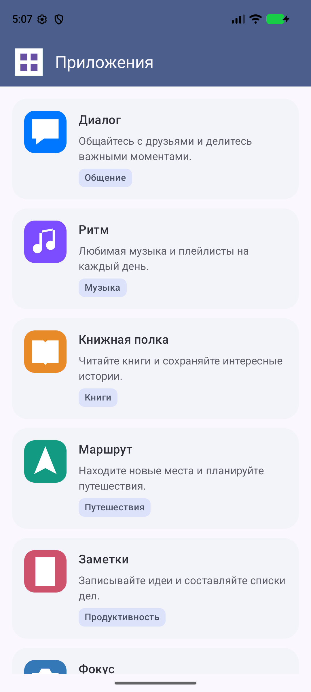
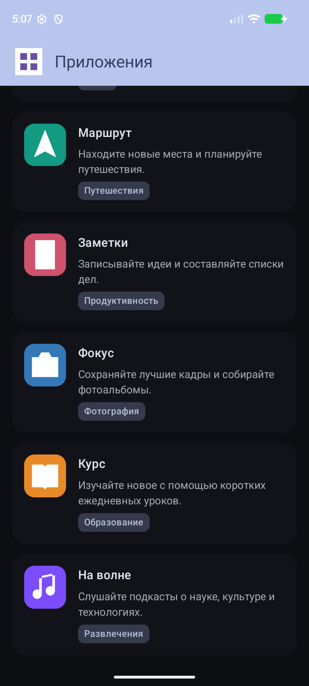

# Практическое задание 4 — UI в Android, часть 1

Экран каталога приложений на Jetpack Compose и Material 3.

## Что реализовано

- Тулбар с иконкой текущего приложения слева и акцентным фоном.
- Вертикальный прокручиваемый список на `LazyColumn` со стабильными ключами.
- В каждой карточке: локальная иконка, название, краткое описание и категория.
- Восемь заранее заданных приложений; интернет и разрешения не требуются.
- Светлая и тёмная темы, системные отступы, перенос текста и Compose Preview.

## Где находится решение

- `MainActivity.kt` — точка входа.
- `ui/apps/AppListScreen.kt` — модель, демонстрационные данные и компоненты экрана.
- `res/drawable/ic_*.xml` — локальные векторные иконки.

Пути к исходникам указаны относительно `app/src/main/java/com/example/firsttry`.
Учебный пример: https://github.com/maltsevmicyou/VkEducation

## Запуск и проверка

Откройте проект в Android Studio, дождитесь синхронизации Gradle и запустите `app`
на устройстве или эмуляторе с Android 7.0 (API 24) и выше.
Нужен Android SDK 37; путь к SDK задаётся локально в `local.properties`.
Gradle настроен на Java 25 с автоматической загрузкой.

```text
./gradlew assembleDebug testDebugUnitTest lintDebug
```

## Самопроверка

Проверено: `assembleDebug`, `testDebugUnitTest` и `lintDebug` успешно завершились
при локальном запуске на Java 22 (временно заменён только критерий JVM Gradle).
Исходная настройка Java 25 сохранена. Lint не обнаружил ошибок; остаются
предупреждения исходного проекта, в том числе о доступных обновлениях зависимостей.
В эмуляторе Pixel 8 проверены запуск, светлая и тёмная темы и прокрутка до конца списка.

1. При запуске сверху виден акцентный тулбар с иконкой приложения слева.
2. Под ним показаны карточки со всеми четырьмя полями.
3. Список прокручивается до приложения «На волне».
4. При смене ориентации, темы и увеличении шрифта текст остаётся читаемым.
5. В авиарежиме данные и иконки доступны.

## Скриншоты

| Светлая тема | Тёмная тема, конец списка |
| --- | --- |
|  |  |
